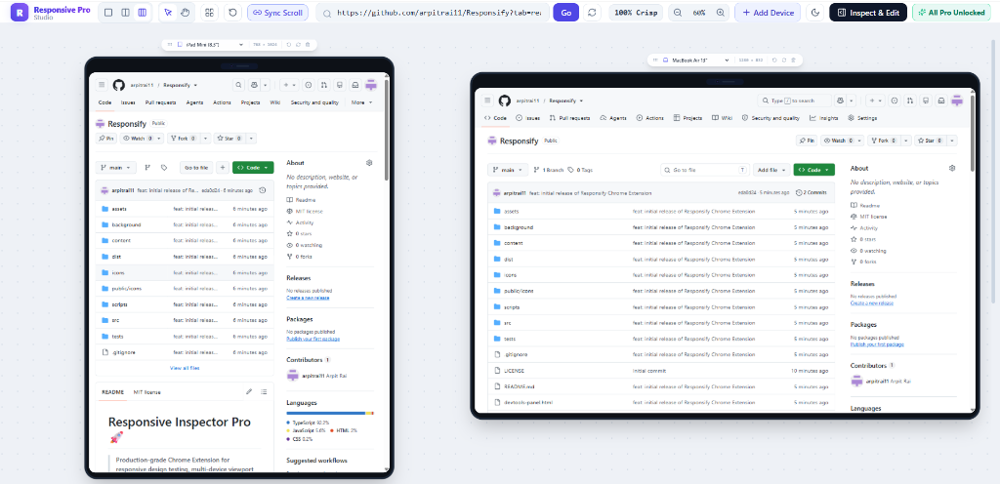
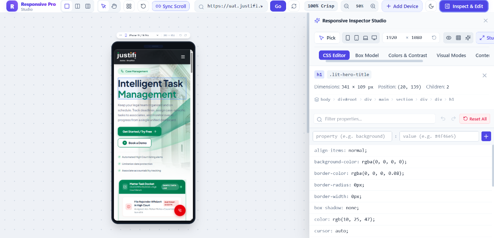

# Responsify (Responsive Inspector Pro) 🚀

> **Production-grade Chrome Extension for responsive design testing, multi-device viewport inspection, live CSS editing, and visual debugging.**

<p align="center">
  
</p>

Responsify provides a full-screen responsive studio workspace with **every feature 100% unlocked** — no subscription modals, no feature locks, and no paywalls.

---

## 🌟 How It Works

1. **One-Click Instant Launch**: Click the extension icon in your Chrome toolbar while browsing any webpage (or your local development server).
2. **Full-Page Studio Opens Automatically**: A new tab opens immediately with the **Responsive Studio Workspace** loaded with your target website.
3. **Multi-Device Simultaneous Testing**: View your website rendered side-by-side across:
   - 📱 **Mobile** (iPhone 15/16 Pro, Pixel 8, Galaxy S24, etc.)
   - 📟 **Tablet** (iPad Air, iPad Pro, Galaxy Tab, etc.)
   - 💻 **Laptop & Desktop** (MacBook Pro 16", Full HD 1080p, Ultrawide, etc.)
4. **Synchronized Scrolling**: Scroll any device viewport, and all other viewports automatically scroll in sync.
5. **No X-Frame-Options Blocking**: Uses Chrome's `declarativeNetRequest` API to strip `X-Frame-Options` and CSP `frame-ancestors` on preview sub-frames so any website can be previewed seamlessly.
6. **Built-in DevTools Inspector Drawer**: Click **Inspect & Edit** in the top bar to slide out the full developer suite: Element Picker, Live CSS Editor, Box Model, Colors & WCAG Contrast Checker, Text & Image Editor, Media Asset Downloader, and Change History.

---

## ✨ Features Overview

### 📱 1. Multi-Device Responsive Studio
- **Infinite Canvas Workspace**: Freely drag, pan, and arrange devices side-by-side with no screen constraints.
- **Pick & Move Screens**: Grab the drag handle (`:::`) on any device card header to reposition screens anywhere on the canvas.
- **Select & Hand Pan Tools**: Toggle between the **Select Tool** (to move devices) and the **Hand Tool** (to pan the canvas). Also supports Middle Mouse Button or `Space + Click Drag`.
- **Synchronized Scrolling**: Scroll one device and all other devices scroll together in real time.
- **`Ctrl + Scroll` Interior Scrolling**: Hover over any device frame and use `Ctrl + Mouse Wheel` to scroll the inner page smoothly.
- **100% Crisp Native Rendering**: One-click toggle locks zoom to 1:1 native resolution with font antialiasing and subpixel sharpness, eliminating CSS downsampling blur.
- **Orientation Flipping**: Rotate individual devices or all active viewports between Portrait and Landscape with one click.
- **Device Preset Library**: Comprehensive catalog of popular devices across **Mobile**, **Tablet**, **Laptop**, and **Desktop** (iPhone 16 Pro, iPad Pro, MacBook 16", 4K Displays, etc.).
- **Auto-Align Grid**: One-click button to reset device positions into a clean, organized canvas layout.

### 🎨 2. Visual Modes & Accessibility Testing
- **Adaptive Column Grid**: Overlay responsive 4, 8, 12, or 16-column grids directly over active viewports with customizable margins, gutters, opacity, and dashed color guides.
- **Color Blindness Simulator**: Test accessibility using real-time SVG matrix filters:
  - 👁️ **Protanopia** (Red-weak)
  - 👁️ **Deuteranopia** (Green-weak)
  - 👁️ **Tritanopia** (Blue-weak)
  - 👁️ **Achromatopsia** (Complete color blindness / monochrome)
- **Dark Theme Simulation**: Instant contrast and dark-mode simulation filter to preview readability in low-light environments.
- **X-Ray Structural Wireframe**: Reveals structural bounds, flexbox containers, and CSS grid lines to quickly diagnose layout shifting and overflow issues.

### 🛠️ 3. Built-in DevTools & Live Editing Drawer

<p align="center">
  
</p>

- **Live Element Picker**: Interactive crosshair tool to point and click on any element within viewports to inspect its DOM node, tag name, classes, and dimensions.
- **Interactive Box Model**: Visual representation of Margin, Border, Padding, and Content box dimensions with live inline tweaking.
- **Live CSS Editor**: Add, modify, or remove CSS properties in real time with instant visual feedback and persistent undo/redo.
- **Color Inspector & WCAG Contrast Checker**: Automatically calculates color contrast ratios with WCAG AA and AAA compliance badges for accessible typography.
- **Content & Image Editor**: Edit copy and text directly in the DOM, or swap image source URLs to preview mock content live.
- **Media Asset Downloader**: Automatically scans and catalogs all SVG vectors, PNG/WebP images, and CSS background assets with one-click downloading.
- **Change History & Export**: Complete audit trail of all applied CSS, text, and image modifications, exportable as clean CSS rules or JSON.

### 🔓 4. 100% Unlocked Pro Experience
- **No Feature Locks**: Every single capability is available out of the box.
- **No Subscriptions**: Zero paywalls, sign-up forms, or disabled "Pro" buttons.
- **Frame-Busting Bypass**: Built-in `declarativeNetRequest` engine strips `X-Frame-Options` and CSP `frame-ancestors` so any website can be previewed seamlessly.

---

## 🛠️ Top Bar & Workspace Controls

- **Layout Modes**:
  - `Single`: Focus on one specific device viewport.
  - `Split`: Side-by-side dual comparison (Mobile + Laptop).
  - `Multi`: Triple comparison (Mobile + Tablet + Laptop).
- **Pick & Move Screens**: Grab the drag handle (`:::`) on any device header to freely reposition and arrange screens anywhere across the infinite workspace canvas.
- **Canvas Hand / Pan Tool**: Switch between **Select Tool** (to move devices) and **Hand Tool** (to pan across the entire canvas). You can also pan instantly by holding the Middle Mouse button or Spacebar while dragging.
- **Ctrl + Scroll for Internal Scrolling**: Hover over any device and use `Ctrl + Scroll Wheel` to smoothly scroll the website's interior page content. With **Sync Scroll** active, this automatically scrolls all other devices simultaneously.
- **100% Crisp (Native 1:1 Rendering)**: Instantly sets zoom to 100% native resolution for razor-sharp typography and pixel-perfect subpixel rendering, eliminating CSS downsampling blur.
- **Rotate All**: Instantly switch all active devices between Portrait and Landscape.
- **Sync Scroll**: Toggle real-time synchronized scrolling across all viewports.
- **Address Bar**: Test any website URL with immediate live navigation and frame reload.
- **Zoom Controls**: Zoom in, zoom out, or scale the canvas from 30% to 150%.
- **+ Add Device**: Add any preset or custom device to the canvas dynamically.
- **Canvas Theme**: Switch between Light grid and Dark slate canvas.
- **Inspect & Edit Drawer**: Slide out the interactive element inspector and live CSS editor.
- **🌟 All Pro Unlocked**: All features are active with zero paid restrictions.

---

## 🔌 How to Load into Chrome

1. Open Google Chrome and go to: `chrome://extensions/`
2. Turn ON **Developer mode** in the top-right corner.
3. Click **Load unpacked** in the top-left toolbar.
4. Select your extension folder:
   ```
   D:\ResponsiveExtension
   ```
   *(Or the `D:\ResponsiveExtension\dist` subfolder — both are fully compiled and work identically!)*
5. Pin **Responsive Inspector Pro** to your Chrome toolbar.
6. Visit any website (or a local dev server) and click the extension icon to launch the studio!

---

## 🧪 Automated Tests

Run the full test suite with Vitest:
```bash
npm test
```
All 42 tests across 7 test files pass.
